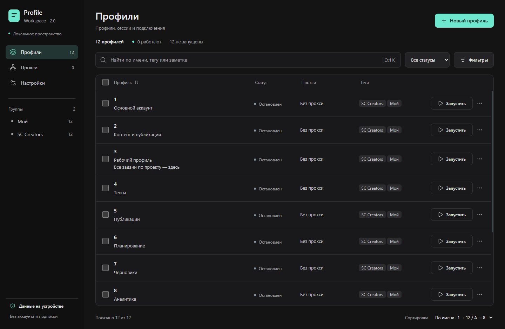

# Profile Workspace

Самостоятельное Windows-приложение для браузерных профилей. Локальные сессии, cookies, прокси, теги и заметки — без аккаунта, рекламы, подписки и искусственного ограничения количества профилей.

[Скачать готовую Windows-версию](https://github.com/Biomistik-Official/Profile-Workspace/releases/latest)



## Запуск

Скачайте [Profile-Workspace-Setup-2.0.1.exe](https://github.com/Biomistik-Official/Profile-Workspace/releases/download/v2.0.1/Profile-Workspace-Setup-2.0.1.exe) из [релиза v2.0.1](https://github.com/Biomistik-Official/Profile-Workspace/releases/tag/v2.0.1). Установщик устанавливает приложение для текущего пользователя Windows и сохраняет прежнюю папку профилей. Node.js и Python не нужны. Версия 2.0.1 использует поведение 0.1.5 с новым интерфейсом, естественной сортировкой и выбором тегов кнопками.

Перед установкой закройте приложение, чтобы оно сохранило сессии. Для резервной копии скопируйте всю папку данных после закрытия приложения.

Установленная версия проверяет GitHub Releases через 15 секунд после запуска и каждые 6 часов. Обновления скачиваются автоматически и устанавливаются при закрытии приложения после сохранения сессий. Приложение не перезапускает работающие профили. Статус, ручная проверка и кнопка «Закрыть и обновить» находятся в настройках. Без сети приложение продолжает работать; проверку можно повторить позже. В портативной, исходной и изолированной тестовой сборке автообновление отключено.

Создайте профиль, укажите стартовую страницу и при необходимости прокси. Для восстановления cookies, которые сайт выдаёт только на время сеанса, включите «Восстанавливать session cookies» в настройках профиля. Постоянные cookies и Local Storage сохраняются автоматически. Сайты могут завершать авторизацию на своей стороне независимо от сохранённых данных.

## Что работает

- Вкладка «Группы»: создание без профилей, переименование и удаление с подтверждением. Пустые группы сохраняются после снятия со всех профилей и перезапуска. Существующие теги автоматически становятся группами; выбирать их можно в настройках профиля и массовом редакторе. Удаление группы снимает её с профилей, сохраняя сами профили и их данные.
- Профили с отдельными постоянными хранилищами Chromium, окнами браузера, вкладками, адресной строкой и навигацией.
- Окна авторизации открываются как вкладки с сохранением связи с исходной страницей — для OAuth-входа и привязки социальных сетей.
- Выдвижная панель «Сайты» внутри браузера: кнопка слева сверху открывает Twitch, TikTok, YouTube, Instagram и Supercell Creators. Можно добавлять и удалять свои ссылки; они сохраняются и доступны во всех профилях. Сайты открываются в новых вкладках текущего профиля с его cookies и прокси.
- Создание, изменение, поиск, фильтры и копирование настроек с cookies. Естественная сортировка имён: 1, 2, 3, …, 10, 11, 12.
- Существующие теги добавляются кнопками при создании, редактировании и массовом изменении. Можно вводить свои теги.
- Заметки всегда видны под именем, с переносом строк и без обрезки. Ошибки показываются отдельно.
- Графитовый интерфейс с бирюзовым акцентом, явными действиями, лёгкими анимациями панелей и диалогов; системное отключение анимаций поддерживается.
- Cookies: просмотр по доменам, поиск, скрытые по умолчанию значения, копирование, импорт JSON/Netscape с предварительной проверкой, объединение/замена, экспорт и очистка.
- Импорт и изменение cookies выполняются после остановки профиля. Ошибка установки cookies вызывает восстановление прежних cookies. Пустой или невалидный импорт не очищает сессию.
- HTTP/HTTPS- и SOCKS5-прокси, в том числе с логином и паролем; проверка внешнего IP. Недоступный назначенный прокси не заменяется прямым подключением. Непроксируемый WebRTC UDP отключён в браузерных вкладках. [Настройка NordVPN как прокси](docs/nordvpn-proxy.md).
- Массовый запуск и остановка, очередь, интервал и число одновременных операций запуска. Это управление нагрузкой, а не ограничение числа созданных профилей.
- Массовое назначение прокси/тегов, удаление с подтверждением и экспорт cookies выбранных профилей в общий JSON-архив.

## Cookies и данные

Данные по умолчанию находятся в `%APPDATA%\Profile Workspace`. Фактический путь доступен в разделе «Настройки → Данные на устройстве». Запуск с переменной `PROFILE_WORKSPACE_DATA_DIR` позволяет явно выбрать другую папку данных; она также используется автоматическими тестами для изоляции.

Метаданные записываются атомарно в `workspace.json`. Пароли прокси и снимки session cookies шифруются средствами Windows. Cookies, Local Storage и остальные данные сайтов хранятся Chromium в отдельных постоянных разделах. Шифрование привязано к окружению Windows; перенос всей папки под другого пользователя не гарантирует чтение защищённых данных.

Для резервной копии сначала штатно закройте приложение и затем скопируйте папку данных целиком. Экспорт cookies — открытый файл с данными сессий; храните его как пароль. Отдельный JSON-экспорт профиля можно импортировать обратно. Общий экспорт нескольких профилей — архив с объектами `{name, cookies}`, а не файл импорта одного профиля; для переноса отдельного профиля используйте его собственный экспорт.

При ошибке сохранения активной сессии приложение сообщает о проблеме и остаётся открытым для восстановления/экспорта. При ошибке чтения зашифрованного снимка исходный файл не перезаписывается.

## Ограничения первой версии

- Это собственный менеджер с Chromium, без полноценной подмены браузерного отпечатка. Эквивалентность антидетекту Dolphin не заявляется.
- Partitioned cookies / CHIPS пока не поддерживаются. Такие cookies при импорте отклоняются с объяснением.
- Копирование профиля переносит настройки и cookies, но не Local Storage, IndexedDB, расширения или загруженные файлы.
- Chrome-расширения, восстановление открытых вкладок, облачная синхронизация и автоматическое обновление движка не реализованы. Обновление Chromium требует новой сборки приложения.
- Доступ сайтов к камере, микрофону, геолокации и уведомлениям пока запрещён. Некоторые сайты и сценарии авторизации через всплывающее окно могут отличаться от обычного Chrome.
- Проверка IP и предварительная проверка назначенного прокси перед запуском обращаются к `https://api.ipify.org`. Если проверка недоступна, запуск с прокси завершается ошибкой; прямой доступ не используется.
- Проверки выполнены на текущем Windows-компьютере. Работа на отдельной чистой Windows-системе, все варианты HTTPS/SOCKS5-провайдеров и совместимость со всеми внешними сайтами не проверены.

## Разработка и проверки

Нужен Node.js 22.22 или новее совместимой ветки. Зависимости зафиксированы в `package-lock.json`.

```powershell
npm ci
npm run build
npm start
```

```powershell
npm test
npm run test:e2e
npm audit
npm run dist
```

`npm run dev` пересобирает приложение и запускает его; hot reload не настроен. `npm run pack` создаёт распакованную Windows-сборку, `npm run dist` — Windows-установщик NSIS и файлы обновлений; `npm run dist:portable` — портативный `.exe` без автообновления.

Vitest проверяет парсинг cookies, атомарное сохранение метаданных, валидацию, очередь и SOCKS5-посредник. Playwright запускает настоящий Electron с временными данными и проверяет изоляцию, HttpOnly/Local Storage, перезапуски, импорт/откат, сохранение зашифрованных снимков, ошибки закрытия, WebRTC, HTTP/SOCKS5-прокси с авторизацией и интерфейс. Проверки внешнего IP обращаются к ipify через локальные тестовые прокси и требуют сетевого доступа.

Основа реализации сверялась с официальной документацией [Electron Session](https://www.electronjs.org/docs/latest/api/session), [Cookies](https://www.electronjs.org/docs/latest/api/cookies), [safeStorage](https://www.electronjs.org/docs/latest/api/safe-storage) и [WebContents](https://www.electronjs.org/docs/latest/api/web-contents). Оригинальный код Dolphin в приложение не включён; исследование оригинала выполнялось на отдельных временных копиях.

Дизайн разработан с UI/UX Pro Max и методикой unslop — Damir Sokolovsky ([@heydamir](https://x.com/heydamir)), CC BY 4.0.
